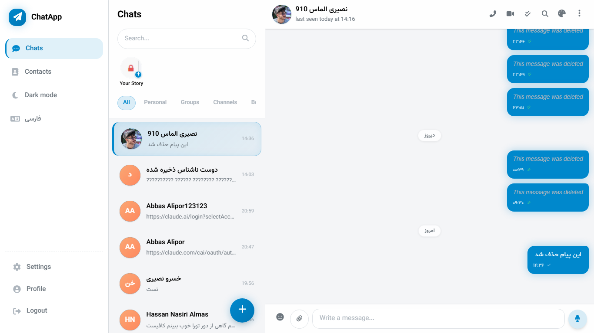
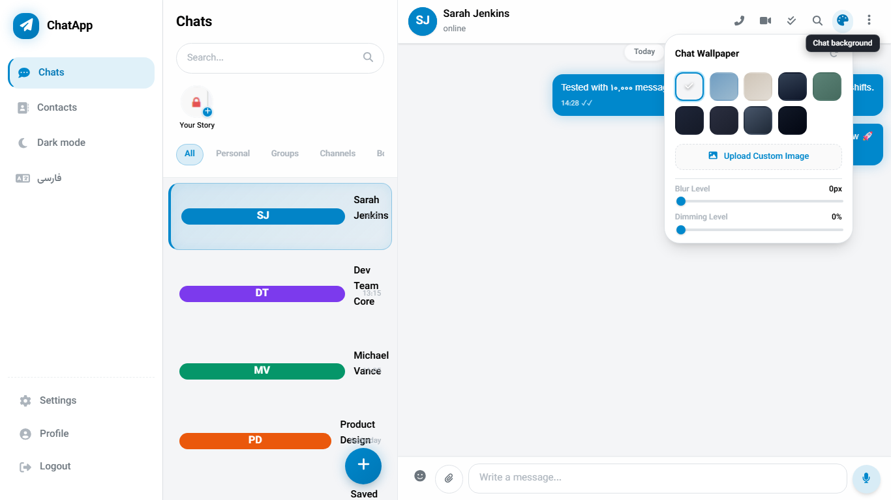
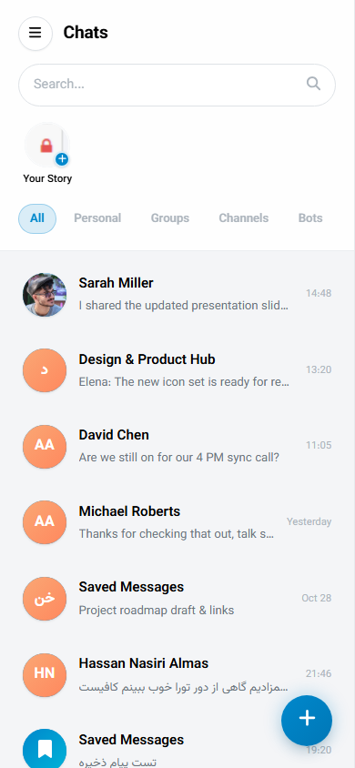
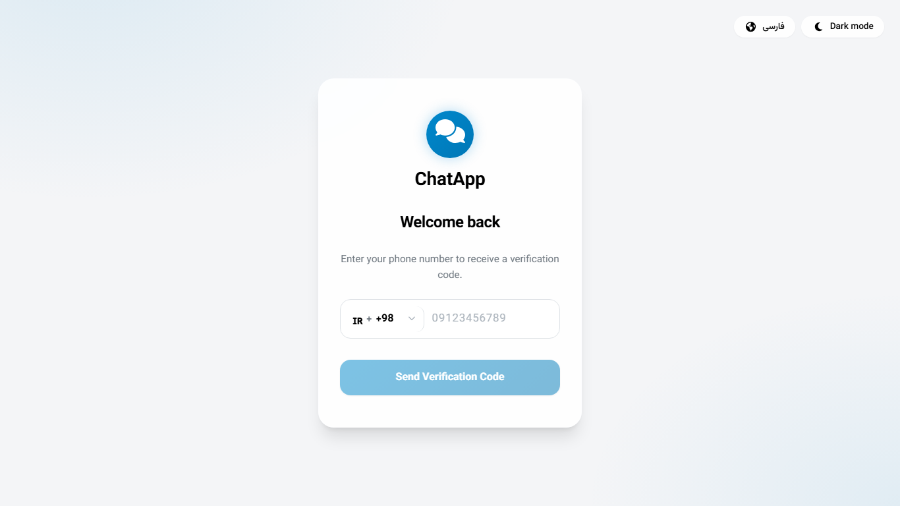

# ChatApp

اپلیکیشن پیام‌رسان متن‌باز Real-time الهام‌گرفته از تلگرام با معماری مدرن NestJS 11 و Angular 22.

---

## نماهای برنامه (Screenshots)

| صفحه اصلی چت (Desktop) | پنل تنظیمات والپیپر و بلور |
| :---: | :---: |
|  |  |

| نسخه موبایل (Responsive PWA) | ورود با کد یکبار مصرف (OTP) |
| :---: | :---: |
|  |  |

---

## پشته فنی (Tech Stack)

### بک‌اند (Backend)
- **فریم‌ورک**: NestJS 11 (TypeScript) با معماری ماژولار
- **پایگاه داده**: MongoDB + Mongoose ODM
- **ارتباط زنده**: WebSockets با Socket.io
- **امنیت و احراز هویت**: JWT (Access Token + Refresh Token) و Rate-Limiting با Throttle Guard
- **هوش مصنوعی**: ماژول Agentic سازگار با OpenAI API و Google Gemini (ابزارهای خلاصه‌سازی، استخراج تسک، پیشنهاد پاسخ)
- **تست**: Jest (تست‌های واحد) + Supertest (E2E)

### فرانت‌اند (Frontend)
- **فریم‌ورک**: Angular 22.2 (Standalone Components, Signals & Reactive Architecture)
- **رابط کاربری**: Angular Material + FontAwesome + SCSS (سیستم متغیرهای CSS و تم تلگرامی)
- **لیست پیام‌ها**: CDK Virtual Scroll (پیمایش سریع هزاران پیام بدون افت فریم)
- **چندزبانه (i18n)**: فارسی (RTL)، انگلیسی (LTR)، عربی (RTL)
- **تست**: Playwright E2E Testing

---

## امکانات پیاده‌سازی‌شده (Features)

### گفتگو و پیام‌رسانی
- **چت بلادرنگ**: ارسال و دریافت آنی پیام‌ها با Socket.io و وضعیت‌های ارسال، تحویل و خوانده‌شدن (Checkmarks)
- **انواع پیام**: پیام متنی، تصاویر، ویدیو، وویس، فایل و استیکر
- **حذف پیام‌ها**: امکان حذف دوطرفه (Delete for everyone) یا یک‌طرفه (Delete for me)
- **ارسال مستقیم از کلیپ‌بورد**: چسباندن عکس با `Ctrl+V` یا منوی راست‌کلیک در اینپوت چت
- **ویرایش پیام**: ویرایش درون‌خطی پیام‌ها با برچسب (edited)
- **ری‌اکشن**: ارسال و حذف ایموجی روی پیام‌ها
- **پیش‌نمایش لینک (Link Preview)**: استخراج عنوان، توضیحات و تصویر وب‌سایت‌ها از لینک‌های درون متن

### مدیریت گفتگوها و گروه‌ها
- **پوشه‌بندی و تب‌ها**: دسته‌بندی چت‌ها به شخصی، گروه‌ها، کانال‌ها، ربات‌ها
- **پیام‌های ذخیره‌شده (Saved Messages)**: فضای ابری خصوصی برای یادداشت‌ها و فورواردها
- **کانال‌ها و گروه‌ها**: ایجاد گروه/کانال، تعیین ادمین‌ها و مجوزهای دسترسی اعضا
- **جستجوی درون چت**: جستجوی متنی لحظه‌ای در تاریخچه گفتگو همراه با هایلایت و ناوبری بین نتایج

### پروفایل، امنیت و مخاطبین
- **ورود با شماره موبایل**: ارسال و بررسی کد ۶ رقمی OTP با پیش‌شماره کشورهای مختلف
- **حفظ حریم خصوصی شماره**: نمایش شماره تلفن فرستنده ناشناس تنها در صورتی که او شما را ذخیره کرده باشد
- **استیکی بنر فرستنده ناشناس**: دکمه‌های مستقیم ذخیره به مخاطبین، بلاک و نادیده‌گرفتن
- **ویرایش مخاطب با نام دلخواه**: ثبت نام و نام خانوادگی اختصاصی برای شماره‌ها
- **مدیریت آواتار**: انتخاب تصویر، برش کادر مربع (Square Crop 500x500)، حذف آواتار و سینک آنی سوکت

### رابط کاربری و شخصی‌سازی
- **والپیپرهای SVG و الگوهای پس‌زمینه**: پترن‌های وکتوری الهام‌گرفته از تلگرام (دودل، ستاره، شش‌ضلعی، سایبر) با رنگ‌های پاستلی
- **تنظیمات زنده تصویر پس‌زمینه**: اسلایدر بلور (0–20px) و اسلایدر تاریکی/کنتراست (0–80%)
- **آپلود تصویر پس‌زمینه دلخواه**: بارگذاری عکس شخصی برای محیط گفتگو
- **جداساز کپسولی تاریخ**: نمایش تاریخ روز به صورت شیشه‌ای (Glass Pill) شناور و واکنش‌گرا
- **واکنش‌گرا (Responsive)**: پشتیبانی یکپارچه از مانیتور دسکتاپ، تبلت و گوشی موبایل (PWA)

---

## راه‌اندازی و اجرا (Getting Started)

### ۱. اجرای سریع با Docker Compose (توصیه‌شده)

```bash
# ۱. کپی متغیرهای محیطی
cp chat-app-back/.env.example chat-app-back/.env

# ۲. اجرای کامل سرویس‌ها (MongoDB + API + Web)
docker compose up -d --build
```

- رابط کاربری وب: `http://localhost`
- وب‌سرویس بک‌اند: `http://localhost:3000/v1`
- پایگاه داده مونگو: پورت `27017`

### ۲. اجرای دستی برای توسعه (Development)

**بک‌اند (`chat-app-back`)**:
```bash
cd chat-app-back
npm install
npm run start:dev   # پورت 3000 با پیشوند v1
```

**فرانت‌اند (`chat-app-front`)**:
```bash
cd chat-app-front
npm install
npm start           # پورت 5500 با هاست 0.0.0.0
```

---

## تست‌ها و اعتبارسنجی (Tests & Quality)

```bash
# تست‌های بک‌اند (Jest)
cd chat-app-back && npm test

# بررسی استاندارد کد بک‌اند
cd chat-app-back && npm run lint

# بیلد پروداکشن فرانت‌اند
cd chat-app-front && npm run build
```

---

## مجوز (License)

پروژه به صورت متن‌باز تحت پروانه [MIT](LICENSE) منتشر شده است.
